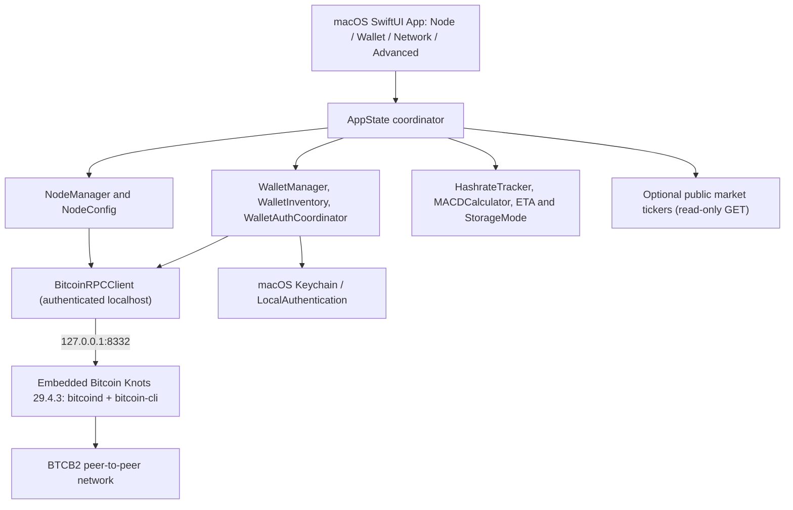

# Current Architecture — Sentinel Node Wallet BTCB2

**Aligned with GitHub [v1.0.0 Build 3](https://github.com/PeterJFrancoIII/sentinel-node-wallet-btcb2/releases/tag/v1.0.0-build3), November 14, 2026.** This describes the source-level design, **not** independent acceptance of the signed installer or wallet financial safety. For current release gates see [Project Status](PROJECT_STATUS.md) and [Security](../SECURITY.md).

## Application layers

- Swift Package Manager `Package.swift` declares `NodePocketApp`, `NodePocketCore`, and test modules; native views are in `Sources/NodePocketApp/Views`. The release scripts build Swift, wrap the executable in a macOS `.app`, and embed verified Knots binaries.
- The app controls an owned or explicitly adopted Knots daemon. RPC is bound `127.0.0.1` by `server=1`, `rpcbind=127.0.0.1`, `rpcallowip=127.0.0.1`, default port 8332; `port=8333` for P2P. Normal app is **MainNet-only**. A sandboxed child daemon actually accepting loopback and optionally external P2P needs appropriate effective macOS network entitlements and native tests.
- **App Store identity in packaging source:** app record `6833290684`, bundle ID `pool.sentineldefensetechnologies.co.za`, version `1.0 (3)`. Historic `com.nodepocket.btcb2` and `app.nodepocket.btcb2` identifiers are not the current packaging identifiers.
- Cloud wallet management, central custody, brokerage/order execution and mining are not components of this app. Local management and wallet data are distinct from optional public ticker HTTPS requests.

## Consensus and analytics

The app supports BTCB2's BLAKE2b/BIP-110 activation; the source consensus anchor lives in `Sources/NodePocketCore/Consensus/BTCB2Consensus.swift`. The node is pinned to `29.4.3.knots20260508` in build scripts. A historical fork-activation checkpoint is also encoded in source; do not update it based on an assumption about legacy Bitcoin history.

Network hashrate is estimated from consensus block data locally. The Network screen includes a rolling 30-block dot plot, fast/slow EMA overlays, MACD, signal and histogram, plus difficulty and peer observations. These are **statistics**, not an exchange order book or mining workload.

## Node resource and storage policy

- New installation: `StorageMode.defaultPruneMB = 2048`; minimum user-configurable prune = 550 MiB; `pruneduringinit=550`. Retention target does not cap chainstate, wallet database or temporary sync disk use.
- Archival mode is an explicit opt-in, subject to external volume capacity rules; prior operator settings and on-disk `bitcoin.conf` should be preserved.
- Default sync profiles (threads/cache MiB/maximum peers): Quiet **1/128/3**, Balanced **2/256/8**, Fast **4/1024/24**, automatic Ultra battery **1/128/4** with `listen=0`. User overrides are persisted in `profile_settings.json`.
- Connected peer count is not the same thing as maximum connection allowance; inspect actual running daemon options and logs rather than assuming the profile's configured cap is reached.

## Wallet, security, and destructive flows

- Descriptor wallets are local to the node's wallet storage; operator registry and ownership checks separate multiple local users. Passwords/TOTP use local authentication and macOS Keychain APIs.
- The RPC layer defaults `isBroadcastRestricted=true`; WalletManager checks it before actual send and RBF execution. The ability to disable this guard exists in source; independent BTCB2 fork-specific signing acceptance is still required before use with funds.
- `WalletInventory.deleteWalletFromMac` currently rejects individual-wallet deletion until there is an independent isolated restore proof bound to the exact wallet and backup digest. Nondestructive Archive remains.
- **Full app uninstallation differs materially:** `AppState.fullyUninstallApplicationAndAllFiles` and `scripts/clean_uninstall.sh` can erase node, wallet and configuration files. They are intentionally destructive and must not be confused with safe Archive or documented as automatically recoverable.
- External market tickers use read-only public GET endpoints; blockchain peers and remote market-data services receive source IP/network metadata despite local RPC isolation.

## Packaging channels and audit limitations

| Path | Checked-in behavior | Not proven by that behavior |
|---|---|---|
| `scripts/build_app.sh` | Swift arm64 build and `.app` wrapping with pinned Knots | Distribution trust |
| `scripts/build_dmg.sh` | Drag-to-Applications DMG, optional **Apple Development** signing and SHA-256 checksum | Developer ID notarization, Gatekeeper acceptance |
| `scripts/package_appstore_archive.sh` | Manually assembles Xcode archive bundle, sandbox entitlements and signs with Apple Development identity | App Store acceptance/cloud distribution signature unless separately witnessed |
| `scripts/build_production_dmg.sh` | Guarded Developer ID/notary workflow for approved outside-store candidate | Execution, public signing or safety acceptance merely because script exists |

The [GitHub release](https://github.com/PeterJFrancoIII/sentinel-node-wallet-btcb2/releases/tag/v1.0.0-build3) is published but GitHub CI only confirms tests, an ad-hoc bundle and ephemeral Knots CLI backup→restore. No production funds may be involved in qualification.
